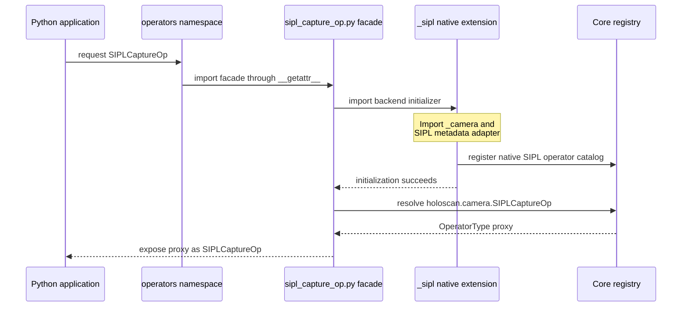

# Holoscan Camera Python support

Holoscan Camera exposes native camera operators to Holoscan SDK 5 Python graphs
through the `holoscan_camera` package. Capture, buffer ownership, timestamps,
and lifecycle handling remain in C++; Python applications construct graphs and
consume the SDK's typed payloads and tensor interfaces.

The Python package exposes V4L2, Argus, and SIPL operator APIs. Optional backends
load when their API is requested and require a compatible BSP runtime; see the
[Argus guide](../operators/argus_capture_op/python/README.md) and the [SIPL guide](../operators/sipl_capture_op/python/README.md). See [V4L2](#v4l2) for its operator interface
and the [Python application guide](../applications/holoscan_camera_v4l2/python/README.md)
for capture, preview, and hardware tests.

## Binding approach

The package uses the SDK's C++ authoring registry and nanobind stable-ABI
initializers, following the SDK Vision, Visualization, and Inference modules.
Importing the package loads Core and registers the portable V4L2 catalog;
requesting SIPL or Argus imports its independent native extension and catalog.
Importing the package does not open a camera or start capture.

### Facades, native extensions, and typing

An operator **facade** is a small Python module such as
`operators/sipl_capture_op.py`. It imports the backend initializer, then calls
`holoscan.registry.resolve()` to expose a Core `OperatorType` proxy under the
public operator name. Calling that proxy adds the C++ operator to a graph and
returns an `OperatorHandle`. Camera does not bind a separate Python operator
class for each capture backend.

The **native extensions** are compiled modules. `_camera` registers V4L2 and
shared payload support; `_argus` and `_sipl` register their own catalogs and have
separate native library dependencies. `_sipl` also uses nanobind to expose
`SIPLCaptureService`, `CameraInfo`, `PixelFormat`, and `BayerFormat` directly.
Those service and value types do not go through the operator facade or registry
proxy. Capture, buffer ownership, and device lifetime remain in C++ in both cases.

For example, requesting the SIPL operator follows this sequence:



The package namespaces defer importing the optional facade until its name is
requested. Importing the facade itself loads its native extension immediately;
loading is not deferred until the operator is constructed. V4L2 uses `_camera`,
and Argus follows the SIPL sequence with `_argus` and its own metadata adapter.
Accessing `holoscan_camera.SIPLCaptureService` loads `_sipl` directly instead.

The `.pyi` files describe the API for static type checking. Operator stubs are
registry-derived declarations, while `_sipl.pyi` describes the directly bound
service and value types. The optional-backend declarations are committed and
copied into the package so a header-only builder need not import BSP-dependent
binaries to stage typing. They still need comparison with the live registry and
bindings on a compatible runtime. A facade or stub does not provide a native
backend or establish that the host can run it.

Operator constructor arguments are immutable and can be replayed when a graph
is cloned. Native constructors validate operator-specific settings. The build,
import, installation, and testing conventions below apply to the Camera Python
package.

### Operator registration

With V4L2 enabled, importing Camera loads the native initializer in
[_camera.cpp](_camera.cpp), which calls `register_v4l2_operator_catalog()`.
The [catalog](../operators/v4l2_capture_op/operator_catalog.cpp) registers a
`holoscan::authoring::RegisteredOperatorType` containing the stable name
`holoscan.camera.V4l2CaptureOp`, its constructor parameter schema, and callbacks
for adding graph instances and accessing their ports and lifecycle declarations.
The Python facade resolves that name through `holoscan.registry.resolve()` to
an `OperatorType` proxy. Calling the proxy adds a native operator to a graph and
returns an `OperatorHandle`; registration and graph authoring do not start capture.

Camera derives its callback adapter from `ManualOperatorRegistrationThunks`
to map the schema's named values to V4L2's existing C++ constructor. Its
`kConstructorReplay` registration describes immutable constructor inputs;
post-construction parameter replacement is rejected.

The corresponding SDK documentation and API contracts are:

- [Registered Operators guide](https://docs.nvidia.com/holoscan/sdk-user-guide/python/registered-operators): provider
  imports, registry discovery, Python proxies, handles, and generated typing.
- `include/holoscan/authoring/registry.hpp`: `RegisteredOperatorType` and
  `OperatorParameterIntrospection::kConstructorReplay`.
- `include/holoscan/authoring/register_operator.hpp`:
  `ManualOperatorRegistrationThunks` and the callbacks supplied by a manual registration.

## Import paths and module discovery

`holoscan_camera` is the canonical package: it owns the Python files, native
extension, and generated typing artifacts. Use it with the CMake build/install
and for static type checking:

```python
from holoscan_camera import operators
```

`holoscan.camera` is the SDK's discovered alias for that same package. A Python
distribution enables it by publishing this entry point in its package metadata:

```toml
[project.entry-points."holoscan.modules"]
camera = "holoscan_camera"
```

Once that distribution is installed in the selected Python environment, before
starting the interpreter, the alias also works:

```python
from holoscan.camera import operators
```

Core discovers the metadata when imported and loads Camera only when its alias
is requested. Both paths share the same package, operator module, and native
extension objects, avoiding duplicate initialization and registration. Keep
relative imports inside the provider and canonical imports in typed application
code: type checkers do not automatically resolve runtime entry-point aliases.
Vision, Visualization, and Inference follow the same canonical-package/alias
convention.

The Camera CMake build and installation include distribution metadata with this
entry point. Both import paths work when that package root is on the selected
interpreter's import path before Core is imported. Discovery tests verify both
import orders; published wheel qualification remains separate.

CMake builds and installs are managed by CMake, not pip. Their distribution
metadata supports provider discovery but does not include pip's `RECORD` file.
Use a separate installation prefix and add its Python package directory to
`PYTHONPATH`; do not install a Camera wheel into that same package directory.
Use the build's `install_manifest.txt` to identify CMake-installed files. For
pip-managed installation and removal, build and install a wheel instead.
When Camera and the SDK use separate prefixes, keep the SDK's shared-library
directory on `LD_LIBRARY_PATH` as required by the SDK runtime environment.

## Build with the SDK

Use a Holoscan SDK 5 revision with downstream operator-stub generation and declaration
coverage checks for the Camera Python package. For source builds, the SDK's stub
helper must collect `HOLOSCAN_PYTHON_IMPORT_DEPENDENCIES` from extension targets.

Build the SDK with Python enabled, shared libraries, and its Python dependency
toolchain (CPython 3.12 and nanobind 3.0.1). From the SDK source directory
containing its `run` script:

```bash
./run build --build-python true --build-benchmarks false \
  --config '-DBUILD_SHARED_LIBS=ON -DHOLOSCAN_BUILD_CAMERA=ON -DHOLOSCAN_CAMERA_BUILD_PYTHON=ON -DOP_v4l2_capture_op=ON'
```

The SDK's Camera dependency must select the Camera revision containing these
bindings using `HOLOSCAN_CAMERA_GIT_REPOSITORY` and `HOLOSCAN_CAMERA_GIT_TAG`,
or an existing source checkout through `CPM_holoscan_camera_SOURCE`. Paths to
source overrides must be visible inside the SDK build container.

When nested in the SDK, Camera follows `HOLOSCAN_BUILD_PYTHON`, reuses its
nanobind target, stages under `HOLOSCAN_PYTHON_MODULE_ROOT`, and adds its extension
and generated stubs to `holoscan-python`. No Python installation is downloaded
by Camera's CMake configuration.

Camera passes Core's Python extension in `EXTENSION_TARGETS` to the SDK stub
helpers. They read Core's `HOLOSCAN_PYTHON_IMPORT_DEPENDENCIES` target property to
wait for package initialization, generated schemas, and schema codecs before
importing Core. Camera does not maintain a separate list of those prerequisites.

## Build against an installed SDK

Building Camera's Python bindings requires a compatible Holoscan SDK 5
development installation providing headers, shared libraries, CMake exports
for `core` and `sensor_io`, and matching Python support. This installation
can come from an SDK development container, suitable Debian packages, or a
custom source build. Python wheels alone do not provide the required SDK
CMake configuration.

These prerequisites support building and using the bindings. See
[Build a Camera wheel](#build-a-camera-wheel) for packaging requirements.
A locally built wheel still requires platform compatibility checks,
appropriate tagging, and runtime qualification before release publication.

Wheel builds enable native V4L2 on both architectures and native SIPL v2 and
Argus on ARM64. Build the ARM64 wheel in the project development image with
`--build-arg L4T_VERSION=39.2.1`; no SIPL v1 wheel variant is produced. The
SIPL build needs fetched development headers, not vendor shared libraries.
Packaging records the SIPL/NvSci runtime dependency names in the wheel copy of
`libsipl_capture_op`; the device BSP supplies those libraries at runtime.

Select native operators explicitly, for example `-DOP_v4l2_capture_op=ON`.
`HOLOSCAN_CAMERA_BUILD_PYTHON` enables the Python package without forcing any
capture operator on. Selecting an application or package can also enable its
required operators through the existing dependency rules.

The Camera 1.0 release support policy applies to Python capture as well as
C++. The table below describes supported capture combinations, rather than
which native extensions can be imported; see the
[platform overview](../README.md#supported-platforms) and
[release limitations](../RELEASE_NOTES.md#known-limitations).

Wheel runtime support is:

| Runtime | V4L2 | SIPL | Argus |
| --- | --- | --- | --- |
| x86_64 Linux | Supported | Unsupported | Unsupported |
| ARM64 SBSA / DGX Spark | Supported | Unsupported | Unsupported |
| IGX R38 | Supported | Unsupported | Unsupported |
| Jetson AGX Orin + JetPack 7.2.1 (R39.2) | Supported | Unsupported | Supported |
| Jetson AGX Thor + JetPack 7.2.1 (R39.2) | Supported | Supported (API v2) | Unsupported |

The wheel ships all operator facades and typing declarations. A backend may
import successfully wherever compatible BSP libraries are present, including
SIPL on Orin; this does not qualify capture or expand the release support
policy. Unsupported backend imports may also fail; their visibility is not a
capability guarantee.
`import holoscan_camera`, `from holoscan_camera import operators`, and importing
`V4l2CaptureOp` never load SIPL or Argus. Explicit imports load only that backend:

```python
from holoscan_camera.operators import V4l2CaptureOp
# On a supported R39 device with the matching BSP runtime:
from holoscan_camera.operators import SIPLCaptureOp
from holoscan_camera import SIPLCaptureService
```

The native extensions are `_camera`, `_sipl`, and `_argus`. Schema exports also
load one metadata family at a time. The standard Linux dynamic linker resolves
vendor dependencies when their extension is imported; the wheel does not
preload vendor libraries or select a BSP based on host detection. A failed
optional import leaves V4L2 available. Avoid wildcard imports on unsupported
platforms: they request every exported backend. `hasattr()`, `getattr()` with a
default, and `inspect.getmembers()` may also trigger an optional import and
raise `ImportError`; they are not backend-availability probes. `dir()` lists
advertised names without loading their backends.

For ordinary CMake source builds, `operators/__init__.py` and `__init__.pyi`
re-export only the selected native backends. With Python enabled, selecting
`OP_argus_capture_op=ON` on ARM64 includes `_argus` and its generated metadata
schema; selecting `OP_sipl_capture_op=ON` includes `_sipl`, its generated metadata
schema, and the directly bound service types. With every backend disabled, an
ordinary source build remains importable and exports no capture operators.

Wheel builds select their native payload by architecture as described above,
while configuring all three operator facades and typing declarations. Metadata
families and their native codecs follow the native backend selection. The
facades and committed operator stubs live beside their implementations in
`operators/<backend>_capture_op/python/`; SIPL's native service bindings and
CuPy converters also live beside its operator.

Use the Holoscan Camera development image for the CLI build and run workflow.
See the [V4L2 application guide](../applications/holoscan_camera_v4l2/python/README.md)
for commands using the currently supported operator and application.

For a direct CMake build, use a CPython 3.12 environment that can already import
the matching SDK 5 `holoscan` package. Set `HOLOSCAN_SDK_ROOT` to that SDK's
installation prefix and run the commands below from the Camera repository root.
The environment's executables, including Pyright, must be available on `PATH`.

Nanobind discovery first uses CMake package paths, such as `nanobind_DIR` or
`CMAKE_PREFIX_PATH`. Native builds can also query the selected Python interpreter
for a package location; that optional lookup is skipped when cross-compiling.
For cross builds, provide nanobind's CMake package through the toolchain or one
of those paths. This only covers nanobind discovery; the SDK's Python toolchain
and stub-generation requirements still apply.

```bash
# Install dependencies for the bindings and their tests.
python3.12 -m pip install -r python/requirements-test.txt

# Build the Python package and tests against the installed SDK.
cmake -S . -B build-camera-python -G Ninja \
  -Dholoscan_ROOT="$HOLOSCAN_SDK_ROOT" \
  -DPython3_EXECUTABLE="$(command -v python3.12)" \
  -DHOLOSCAN_CAMERA_BUILD_PYTHON=ON -DOP_v4l2_capture_op=ON \
  -DHOLOSCAN_CAMERA_BUILD_TESTING=ON \
  -DHOLOSCAN_CAMERA_BUILD_CPP=OFF
cmake --build build-camera-python -j4
ctest --test-dir build-camera-python -R '^python-camera\.' \
  --output-on-failure --no-tests=error
```

These tests run without opening a camera. See [Installation and typing](#installation-and-typing)
for test selection, [V4L2](#v4l2) for binding coverage, and the
[application guide](../applications/holoscan_camera_v4l2/python/README.md#live-capture-tests)
for separate live-camera checks.

## Installation and typing

Ordinary Python installs belong to component `holoscan-camera-python_libs`;
native C++ files remain in `holoscan-camera`. The provider installs its public
facade stubs and `py.typed` together with its generated private-extension stub.
`holoscan_add_nanobind_stubs` generates `_camera.pyi`, while
`holoscan_add_operator_stubs` imports `holoscan_camera` and projects the
`holoscan.camera.` registry rows into a combined build artifact.
`split_operator_stubs.py` retains each selected operator's declarations and their
type dependencies in its own facade stub. Parameters, enum values, and ports
come from the native catalog; the split step does not redefine those types.

With typing enabled, builds generate and install these `.pyi` files. The
per-operator facade stubs are also checked in beside their native operators as
reviewable API references. The check target and drift tests compare those
references with freshly generated output; normal builds do not overwrite the
source copies. Private-extension and schema stubs remain build artifacts.

After changing the native catalog, build and copy the generated facade into
the source tree, then check it:

```bash
cmake --build build-camera-python --target holoscan-camera-operator-stubs
cp build-camera-python/python/lib/holoscan_camera/operators/v4l2_capture_op.pyi \
  operators/v4l2_capture_op/python/v4l2_capture_op.pyi
cmake --build build-camera-python --target holoscan-camera-check-stubs
```

For a nested or sibling SDK build, use its `HOLOSCAN_PYTHON_MODULE_ROOT` for
the generated file. Do not edit or format the generated stub by hand.
The check target runs the SDK's coverage checker and an exact comparison:
private parameter and handle classes are part of the typing contract too.

Typing checks are part of the standard Python tests when stubs are enabled.
Install the test dependencies, including Pyright, into the selected Python
environment and make its executables available on `PATH` before configuring:

```bash
python3.12 -m pip install -r python/requirements-test.txt
cmake -S . -B build-camera-python \
  -DHOLOSCAN_CAMERA_BUILD_PYTHON=ON -DOP_v4l2_capture_op=ON \
  -DHOLOSCAN_CAMERA_BUILD_TESTING=ON \
  -DHOLOSCAN_BUILD_PYTHON_STUBS=ON
cmake --build build-camera-python
ctest --test-dir build-camera-python -R '^python-camera\.' --output-on-failure --no-tests=error
```

`HOLOSCAN_CAMERA_BUILD_TESTING` controls Camera tests. With
`HOLOSCAN_CAMERA_BUILD_PYTHON=ON`, it also registers the package tests and,
when V4L2 is enabled, builds the Python plan helper and registers V4L2 tests.
Set `HOLOSCAN_CAMERA_BUILD_CPP=OFF` to omit the V4L2 C++ sample and native tests while retaining the native operator needed by Python;
this configuration does not require GoogleTest. Leave the C++ option unset or ON
to build both suites, providing GoogleTest for the native tests. Setting
`HOLOSCAN_CAMERA_BUILD_TESTING=OFF` disables both suites.

An explicit `HOLOSCAN_BUILD_PYTHON_STUBS` setting takes precedence, including a
selection inherited from a parent SDK build. Otherwise, Camera follows the
installed SDK's exported `HOLOSCAN_PYTHON_STUBS` value, which records whether
that SDK shipped typing stubs. If this metadata is absent, Camera defaults to ON.

With `HOLOSCAN_BUILD_PYTHON_STUBS=ON`, the standard suite includes stub drift,
100% public type completeness, and consumer typing checks for accepted and
rejected constructor arguments and output-port access. Pyright is required in
this configuration and is included in `python/requirements-test.txt`; set
`HOLOSCAN_CAMERA_PYRIGHT_EXECUTABLE` to select an explicit executable if needed.
With stubs disabled, runtime tests remain enabled and Pyright is not required.

For each built optional backend, its runtime flag
(`HOLOSCAN_CAMERA_RUN_ARGUS_TESTS` or `HOLOSCAN_CAMERA_RUN_SIPL_TESTS`) also enables
CTest checks of its live registry against the committed operator stub and
`mypy.stubtest` of its native module. The registry check invokes the existing
`holoscan-camera-check-<backend>-stubs` build target and runs serially with other
CTest work. The shared stub-surface test checks only the backends selected by
those flags; enabling SIPL does not require Argus to load. Header-only wheel
builds keep copying committed typing files without importing optional backends.

For direct pytest runs, set `HOLOSCAN_CAMERA_TEST_BACKENDS` to a comma-separated
selection such as `v4l2,sipl` on a compatible runtime. The older
`HOLOSCAN_CAMERA_TEST_R39=1` opt-in still selects all three when no explicit
selection is provided. The manual `holoscan-camera-check-r39-stubs` aggregate
also remains available when both optional backends can load. See the backend
guides for their runtime prerequisites.

Set `HOLOSCAN_BUILD_PYTHON_STUBS=OFF` for builds unable to import target binaries;
such builds do not install typing markers. Reconfiguration also removes the
build tree's previous typing artifacts. Use a fresh install prefix to avoid
retaining files from an earlier typed installation or a different operator selection.

## Build a Camera wheel

See [Building](#building) for the CLI command and SDK prerequisites, and
[Import paths and module discovery](#import-paths-and-module-discovery) for
canonical and alias imports. Building a wheel does not publish it.

## V4L2

### Operator interface

`holoscan_camera.operators.V4l2CaptureOp` exposes the native Linux V4L2 capture
operator. Its `frame` output publishes `holoscan.schema.Image` values with a
YUYV tensor of shape `[height, 2 * width]`. Python consumers can inspect image
metadata and access pixels through the SDK tensor/DLPack API. Capture readiness
and the copy out of the V4L2 MMAP buffer remain in C++.

```python
from holoscan_camera.operators import V4l2CaptureOp
```

The constructor accepts `device`, `width`, `height`, `fps`, `frame_id`, and
`memory_kind`. These arguments are immutable, rather than runtime-updatable
parameters. The native constructor validates device names, YUYV geometry, and
supported memory placement. See the [V4L2 operator guide](../operators/v4l2_capture_op/README.md)
for the capture and frame-placement contracts. Its scalar and enum arguments
need no constructor-handle mappings in the binding.

The `memory_kind` argument accepts `"host"` (the default), `"pinned"`, or
`"device"`. Device output requires
`CompileOptions.deployment.bind_tensor_output_device` for the operator instance's
`frame` output and an explicit `holoscan.execution.DeviceId`.
Constructor enum fields also accept the corresponding integer values. To use
an SDK `MemoryKind` enum, pass its `.value`; with `import holoscan as hs`, for example,
`memory_kind=hs.tensor.MemoryKind.PINNED_HOST.value`.

### Graph tests

These tests use a nonexistent device and never start a camera. They check
canonical import order, discovered alias identity with metadata present,
specific constructor diagnostics, Image port identity, explicit GPU
placement, reusable graph embedding, and equality with a graph authored directly in C++.

For the C++ comparison, [v4l2_plan.cpp](tests/v4l2_plan.cpp) builds a standalone
`v4l2_python_plan` executable that compiles a reference graph and writes its plan
as JSON to standard output. CTest passes the executable's path through
`HOLOSCAN_CAMERA_PLAN_HELPER`. The
`test_python_and_cpp_author_the_same_plan` test in [test_v4l2.py](tests/test_v4l2.py)
runs that executable with `subprocess.run`, independently builds the equivalent
graph through the Python bindings, and compares the parsed JSON plans. No C++
graph object is passed to Python, and neither graph starts capture. This checks
that the Python and C++ authoring paths produce the same compiled plan.

### Sample application

See the [V4L2 Python application guide](../applications/holoscan_camera_v4l2/python/README.md)
for environment setup, validation and capture commands, Holoviz preview,
application tests, and live-camera checks. The application and its metadata
live together under `applications/holoscan_camera_v4l2/python/`.

## Wheel builds

### Included operators

| Operator | Wheel | Capture library (bundled) | Python extension (bundled) | Vendor runtime (host, not bundled) |
| --- | --- | --- | --- | --- |
| `V4l2CaptureOp` | x86_64, ARM64 | `libv4l2_capture_op` | `_camera` | None; uses the kernel V4L2 API |
| `ArgusCaptureOp` | ARM64 (R39) | `libargus_capture_op` | `_argus`, Argus metadata codec | `libnvargus_socketclient`, `libnvbufsurface`, `libEGL` |
| `SIPLCaptureOp` | ARM64 (R39, SIPL v2) | `libsipl_capture_op` | `_sipl`, SIPL metadata codec | `libnvsipl`, `libnvsipl_query`, `libnvscibuf`, `libnvscisync` |

Each backend loads in two steps:

1. Python lookup: `holoscan_camera.operators` imports only `_camera`. Accessing
   `ArgusCaptureOp` or `SIPLCaptureOp` imports that backend's facade, which
   imports `_argus` or `_sipl` to register the operator and then resolves it
   through `holoscan.registry`. A failed import raises `ImportError` and is
   retried on the next access.
2. ELF linking: each extension links against its capture library in
   `holoscan_camera/lib`, which links against the SDK libraries in the
   `holoscan` wheel and the vendor libraries above. RUNPATH entries locate the
   Camera and SDK libraries; the dynamic linker finds vendor libraries in the
   host library paths when the extension is imported. Nothing calls `dlopen`.

Both wheels ship every operator facade and typing declaration. The wheel records
vendor runtime libraries as loader dependencies; the device BSP supplies them
when the backend is imported. ARM64 wheels do not imply Jetson or IGX device
qualification; live capture requires separate hardware validation.

### Building

The standalone wheel uses the wheel-layout helper exported by the selected SDK.
The SDK must include that helper and the operator-stub tools. Configure the
wrapper's SDK image as described above, then run:

```bash
./holoscan_camera package holoscan-camera --pkg-generator=WHEEL
```

Inside a prepared development container, add `--local`. The active interpreter
must have `build` installed. The pinned CLI uses an isolated build environment
and the backend versions declared in `pyproject.toml`; wheel outputs go to
`build/dist`. In CI, `HOLOSCAN_CLI_BUILD_PARENT_DIR` selects the candidate output
root. Wheel builds require the Holoscan SDK at `/usr`. CLI 5.0.0 does not forward
the selected SDK root to the wheel backend, so a custom SDK installation is not
yet supported.

This creates `holoscan-camera-cu13` with the Camera provider, its owned native
libraries, typing files, and the `holoscan.modules` entry point. It requires a
shared SDK and Python 3.12 or newer. Core remains in the companion
`holoscan-core-cu13` distribution; Camera's native loader paths find it in the
sibling `holoscan/lib` directory. System CUDA libraries are not bundled.
The wheel uses `cp312-abi3` and a native
Linux architecture tag. The `holoscan-core-cu13` dependency supplies the SDK
runtime. Applications import the canonical `holoscan_camera` package directly.
